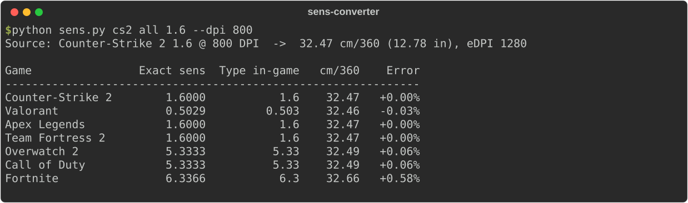
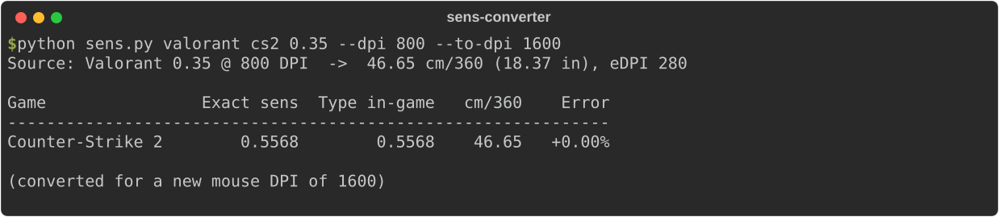
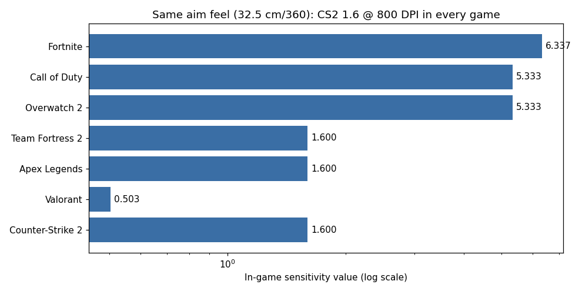
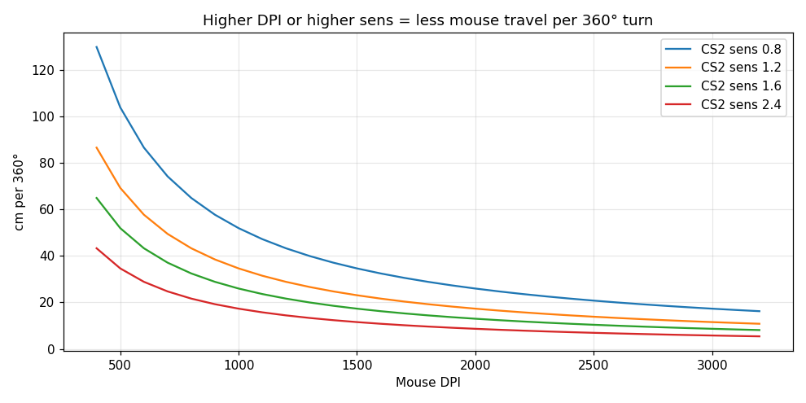
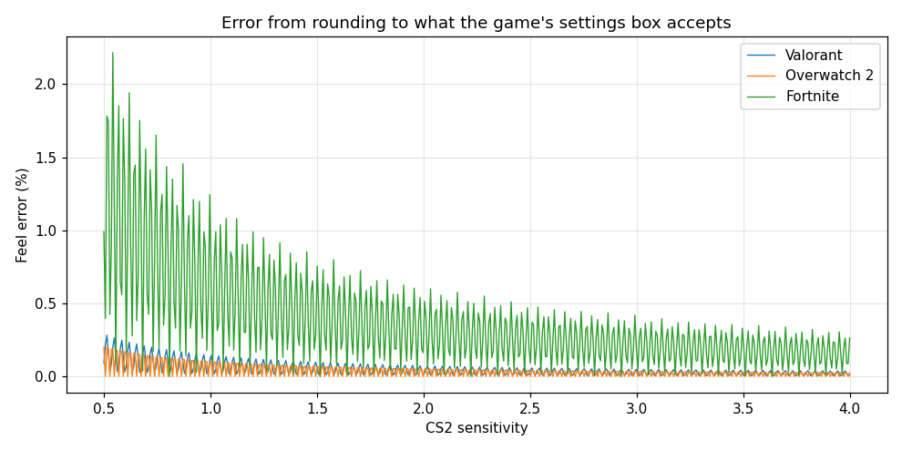

# Game Sensitivity Converter

**Quick summary:** A command-line tool that converts mouse sensitivity between CS2, Valorant, Apex, Overwatch 2, Call of Duty, Fortnite, and TF2, so your aim feels the same in every game. It also works when you switch to a mouse with a different DPI.



## Description
Every game turns your camera by:

```
degrees turned = mouse counts × sensitivity × yaw
```

- **Counts** come from the mouse. DPI is literally "counts per inch".
- **Yaw** is a hidden constant each game uses: CS2 = 0.022, Valorant = 0.07, Overwatch = 0.0066, and so on.

If two setups turn the same number of degrees per inch of mouse movement, they feel identical. The standard way to express that is **cm/360**: how far you move the mouse to spin a full circle. The tool calculates the exact value, the value you can actually type into the game (games limit decimal places), and how much that rounding costs you.

Changing mice? `--to-dpi` gives the new sensitivity that keeps the same feel:



## Tools Used
- **Python** (standard library only for the converter: `argparse`)
- **Matplotlib**: charts
- Unit tests checked against published reference values (e.g. CS 1.0 @ 800 DPI = 51.95 cm/360)
- The same formula is also ported to **JavaScript** as a live demo on my portfolio website

## Scope
- Hipfire (unscoped) sensitivity across 7 games, any DPI
- Out of scope: ADS/scope multipliers and FOV-based matching (these differ per game and per weapon)

## Objective
Solve a real problem gamers argue about with math instead of guesswork. It's also practice in unit conversion, input validation, and data-driven testing, which are the same habits needed when converting subnet masks, bandwidth units, or timestamps in IT work.

## Result
- Conversions are exact to floating-point precision (round-trip tests pass for every game pair).
- The tool reports rounding error honestly. Fortnite only accepts one decimal, so low sensitivities can be up to about 2% off, while Valorant and Overwatch stay under about 0.25%.





## What I Learned
- Games can look completely different (0.5 in Valorant vs 5.33 in Overwatch) while feeling the same. The numbers only mean something once you include the hidden constant, which is the same lesson as comparing units in any system.
- **eDPI** (sens × DPI) only compares players within the same game. cm/360 works across games.
- Validating input at the boundary (`sens > 0`, `dpi > 0`) prevents division-by-zero crashes and nonsense output.
- Charting the error exposed a sampling artifact: my first chart used steps that happened to line up with Fortnite's rounding and showed a misleading flat line. Checking your graphs matters.

## Run It
```bash
python sens.py cs2 valorant 1.6 --dpi 800
python sens.py cs2 all 1.6 --dpi 800
python sens.py valorant cs2 0.35 --dpi 800 --to-dpi 1600
python test_sens.py
pip install matplotlib && python charts.py   # regenerate charts
```
Games: `cs2 valorant apex tf2 overwatch2 cod fortnite`
